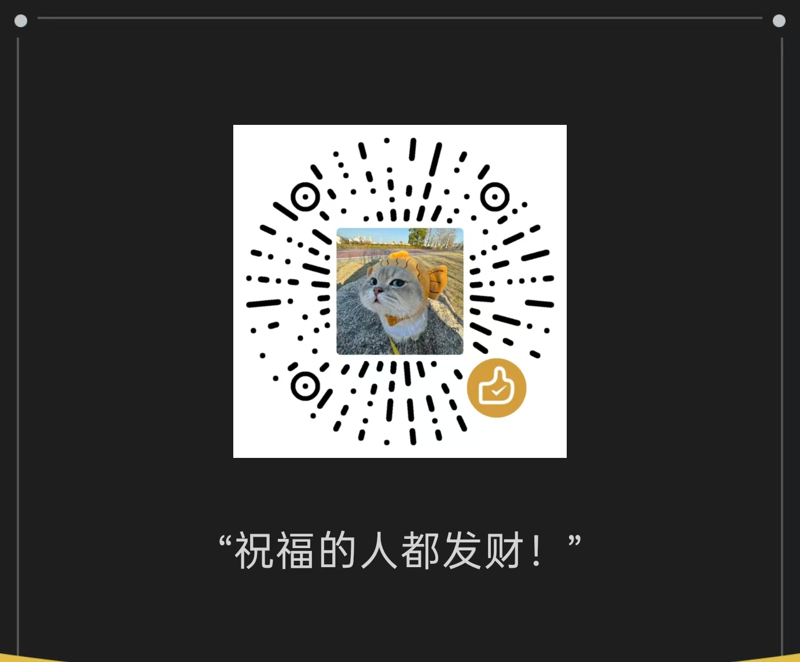

# Muse Video Prompt Skill

> 面向 **Muse 内置视频（Muse Video）** 的电商带货提示词工程手册
> 覆盖 TikTok Shop 美区 + 中国抖音电商双平台 · 全类目通用 · 只产提示词

<p align="center">
  
  
  
  
</p>

---

## 这是什么

做 AI 电商带货视频，最难的部分从来不是点「生成」。

难的是这三件事：

| 痛点 | 真实后果 |
|---|---|
| **产品图跟成片长得不一样** | 平台判定「货不对板」，扣 8 分、限流、下架 |
| **人物中途换脸、配饰消失** | 观众一眼看出是 AI，转化率腰斩 |
| **画面过度干净、过度锐利** | 磨皮脸 + 塑料质感，怎么调都假 |

这个 Skill 就是来解决这三件事的。它把「产品图 + 一句话需求」变成**可直接粘贴使用的视频提示词**，在写提示词的阶段就把这三种翻车堵死。

**它不生成视频，不剪辑，不负责后期。** 生成交给你自己的工具，它只负责把提示词写到能用。

---

## 核心能力

### ① 双锁一致性契约

不是空泛地写「保持一致」——那句话模型会直接忽略。它拆成可观察的物理不变量：

**产品锁**
- 材质与透光性
- 几何形状与比例
- 颜色分区
- 部件白名单（逐一点名，禁「各种配件」这类概括词）
- 相对手掌的占比（**零数字尺寸**，天然规避平台 `Mismatch` 违规）

**人物锁**
- 身份锚点（年龄 / 脸型 / 发型 / 发色）
- 固定发饰（抓夹、发圈——最容易中途消失的东西）
- 固定耳饰
- 衣着纹理
- 穿戴物（安全带、围巾）
- 神态纪律：只做自然微表情，禁夸张表情

### ② 真实视频蒸馏光学模型

从真机实拍的爆款带货视频里反推出「为什么它看着像真的」，固化成固定注入的光学底座：

```
Apple iPhone 17 Pro Max 主摄 · bt709 原生色彩
深景深 · 自然自动曝光（窗外轻过曝 / 暗部细噪）
单手举机呼吸漂移 · 手腕移动时轻微动态微糊
零美颜 · 零滤镜 · 零棚拍打光
```

关键洞察：**真实感来自不完美。** 自然过曝、轻微动态糊、细微噪点——这些比任何「高清」「电影感」都有效。

### ③ 三层动作安全分级

穿模和「第三只手」不是靠禁令堵的，是靠动作设计避开的：

| 层级 | 内容 | 规则 |
|---|---|---|
| **Tier 1** | 持续微动 | 呼吸、眨眼、发丝、手臂微晃 —— 默认层 |
| **Tier 2** | 单一受控动作 | 每段只准 1 个（微倾、轻触、单指弹） |
| **Tier 3** | 高危连续动作 | **默认封杀** —— 10 秒内禁止「拆盖+喷洒+换手+盖回」 |

Tier 3 的封杀是核心：实测证明，10 秒里做连续拆装，必导致瓶盖丢失、瓶身变形、手指粘连。

### ④ 双平台物理级硬隔离

| 维度 | TikTok Shop 美区 | 中国抖音电商 |
|---|---|---|
| 提示词语言 | 纯英文 | 纯中文 |
| 口播语种 | 美式英语 / 美西语 | 标准普通话 / 地方方言 |
| 人设 | 北美本地创作者 | 中国本土真人 |
| 场景 | 美式车内 / 家居 | 中国家庭客厅 / 私家车 |
| 信任基调 | 生活切片、自我暴露 | 痛点直击、细节实证 |

**严禁串台。** 英文提示词里塞中文口播，成片会出现「白种人面孔讲中式中文」这种一眼假的效果。

### ⑤ 零违规防火墙

内置确定性校验脚本，交付前自动拦截 7 类违规：

- 价格与货币符号
- 尺寸数字与单位（防 `Mismatch` / `SNAD` 扣分）
- 夸大极限词
- 医疗功效词
- 抽象 AI 摄影词
- 跨市场语种串台
- 正向段误用否定词

### ⑥ 24 项交付闸门

不是建议，是门槛。分 6 组逐项过：

```
A 帧基 5 项    B 产品锁 5 项    C 人物锁 3 项
D 场域 4 项    E 演进 5 项      F 闸门 2 项
```

过不了就改，不交半成品。

---

## 5L 装配结构

所有提示词按五层自上而下装配，每层只解决一类问题：

```
┌─────────────────────────────────────────────────────┐
│  L1  帧基  Frame Base                               │
│      画幅 / 时长 / 原生色彩基底                       │
├─────────────────────────────────────────────────────┤
│  L2  主体锁  Subject Lock                            │
│      产品不变量 + 人物契约                            │
├─────────────────────────────────────────────────────┤
│  L3  场域  Set Field                                │
│      环境 / 光源 / 静态杂物                           │
├─────────────────────────────────────────────────────┤
│  L4  演进  Beat Flow                                │
│      0-3s 钩子 → 3-7s 实证 → 7-10s 收束              │
├─────────────────────────────────────────────────────┤
│  L5  闸门  Gate                                     │
│      限制清单 + 合规声明                              │
└─────────────────────────────────────────────────────┘
```

层与层之间不重叠。正向段只写「会发生什么」，所有禁止项集中在 L5，避免语义打架。

---

## 快速开始

### 调用

在新对话里直接说需求即可：

```
用 muse-video-prompt-skill 帮我写电商带货提示词
平台：TikTok 美区 / 抖音
产品：（附图 + 品名）
时长：10 秒 / 20 秒
```

### 你会收到什么

固定四块结构：

1. **一句话说明** —— 平台 / 品类档位 / 画幅 / 时长 / 语言
2. **一致性锁表** —— 产品不变量 + 人物契约 + 手部分工 + 动作分级
3. **提示词正文** —— 代码块，可直接复制
4. **风险与合规提示** —— 2–4 条

### 手动校验

```powershell
python bin/validate_ecommerce_prompt.py --market us --file prompt.txt
python bin/validate_ecommerce_prompt.py --market cn --file prompt.txt
```

零错误再投产。

---

## 适用场景

| ✅ 适合 | ❌ 不适合 |
|---|---|
| 电商带货短视频提示词（全类目） | 需要生成视频本身 |
| 产品图与成片一致性要求高 | 需要强锁脸（换 Seedance / H3） |
| TikTok 美区 / 抖音双平台投放 | 需要精确 30 秒时间轴 |
| 需要规避平台违规扣分 | 需要剪辑、拼接、配音 |
| 需要可复用的提示词模板体系 | — |

---

## 目录结构

```
muse-video-prompt-skill/
├── SKILL.md                              # 入口：六条铁律 + 五步工作流
├── CONSTITUTION.md                       # 六条设计原则
├── README.md
├── CHANGELOG.md                          # 版本演进记录
├── LICENSE
│
├── references/                           # 按需加载的领域知识
│   ├── ecommerce-universal-engine.md     # ★ 一致性协议 + 实拍光学模型 + T1–T5 品类槽位
│   ├── prompt-template.md                # ★ 5L 装配结构 + 24 项闸门 + 现象改法
│   ├── douyin-vs-tiktok-rules.md         # ★ 双平台隔离矩阵 + 钩子库 + 合规红线
│   ├── personal-defaults.md              # 默认项全表
│   ├── consistency.md                    # 人物一致性写法
│   ├── dialogue.md                       # 四档语种与台词写法
│   ├── model-notes.md                    # 能力边界 → 写法要求
│   ├── stitch-workflow.md                # 多段拆段指南
│   ├── integration.md                    # 与上下游工具衔接
│   └── cases/                            # 实测病理复盘库
│       ├── INDEX.md
│       ├── cases-2026-11-07.md
│       ├── cases-2026-11-10-felt-tree.md
│       └── cases-2026-11-13-beauty-perfume.md
│
├── assets/                               # 图片资源
│   ├── wechat-contact.jpg                # 作者微信二维码
│   └── reward-qr.jpg                     # 赞赏码
│
├── bin/                                  # 确定性工具
│   ├── validate_ecommerce_prompt.py      # ★ 违规与一致性硬检
│   ├── extract_frames.py                 # 抽帧自查
│   └── stitch.py                         # 多段无损拼接
│
└── scripts/
    ├── install.ps1                       # 安装到 DSH 技能目录
    └── sync_to_github.ps1                # 一键同步到云端仓库
```

---

## 品类自适应

提示词不写死品类，按 **T1–T5 形态档位** 自动套用对应的交互语法：

| 档位 | 典型品类 | 交互强制语法 |
|---|---|---|
| **T1** 微型件 | 口红、耳饰、挂饰单片 | 单指捏持外缘，禁双手叠抓 |
| **T2** 瓶罐手持 | 香水、水杯、精华、吹风机 | 单手托中下段，标签朝镜头 |
| **T3** 织物柔软件 | 床品、毯子、衣物、收纳袋 | 家居比例参照，边缘花纹冻结 |
| **T4** 悬挂长条件 | 墙贴、拖把、灯串、晾衣架 | 本体固定，单手操作局部 |
| **T5** 车载固定件 | 杯架、空气炸锅、显示器 | 本体卡紧，只演示局部交互 |

换品类只换档位，一致性协议不变。

---

## 实测案例库

每次翻车都沉淀成案例卡，记录「现象 → 根因 → 根治锁」：

- **毛毡圣诞树 20s** —— 查出 5 大偏差：脑补蘑菇笑脸花、漏掉核心配件、撕贴时挂饰融化、双手交叠、正脸蜡像感
- **美妆香水 VOYAGE NILLA** —— 查出 4 大偏差：表情夸张发胀、瓶盖消失、标签不可读、闭眼狂笑塑料牙
- **抽真空袋 15s** —— 绝对化断言改个人经验句式、1:1 产品物理锚定

---

## 常见问题

**Q：为什么提示词里不许写尺寸数字？**
A：TikTok Shop 会比对视频里的产品视觉比例与后台 Listing 参数。写了尺寸，AI 稍微画大一点就判「货不对板」，一次扣 8 分。改用「一只手能握住」「铺满单人沙发」这类相对参照。

**Q：为什么不建议在 10 秒里做开盖又盖回？**
A：实测必崩。10 秒内连续拆装会导致瓶盖丢失、瓶身变形、手指粘连。要展示开盖状态，拆成独立一段，以「已开盖」开场。

**Q：美区提示词能用中文写吗？**
A：不建议。一是模型对英文的物理与光学描述理解更准；二是语种混用容易带出中式叙事节奏，成片不像美区本地内容。

**Q：能保证产品和人物 100% 一致吗？**
A：不能，这是模型能力边界。本 Skill 做的是把能控的部分控到极致——物理不变量、部件白名单、穿戴物点名、动作分级、24 项闸门。要真正锁脸，换强参考通道。

**Q：我换品类还要改 Skill 吗？**
A：不用。按 T1–T5 判定档位，套对应交互语法即可。

---

## 版本

当前版本 **v7.0.0-independent**，完整演进见 [CHANGELOG.md](CHANGELOG.md)。

---

## 交流与支持

### 联系作者

<p align="center">
  
</p>

扫码添加微信，交流 Muse 提示词写法、电商带货视频落地经验。

添加时建议备注「Muse」，方便识别。

### 赞赏支持

<p align="center">
  
</p>

<p align="center"><i>「祝福的人都发财！」</i></p>

如果这个项目帮你省下了时间，可以扫码请作者喝杯咖啡。完全自愿，不影响任何功能。

### 说明

- 本项目**完全免费开源**，所有功能、文档、脚本均可自由使用
- 赞赏属自愿行为，**不构成任何付费服务或购买关系**
- 扫码添加微信仅为技术交流，**不承诺一对一答疑或定制开发**
- 不通过任何渠道售卖本项目的代码、教程或「内部版」

---

## 使用与署名要求

本项目以 **MIT License** 发布，允许自由使用、修改、商用与再分发。

**但有一条硬性要求：**

> 任何复制、分发、衍生或二次发布的版本，**必须保留本项目的版权声明**：
>
> ```
> Copyright (c) 2026 Ayanlin1688
> https://github.com/Ayanlin1688/muse-Tiktok-Skill
> ```
>
> 并在你的项目说明、文档或致谢页面中**明确标注来源**，注明本项目名称与仓库地址。

具体来说：

| 场景 | 你需要做的事 |
|---|---|
| 自己用 / 团队内部用 | 无需额外操作 |
| 二次修改后自己用 | 保留 `LICENSE` 文件原样 |
| 发布到自己的仓库 | `LICENSE` 保留、README 标注来源链接 |
| 打包成插件 / 工具分发 | 分发物内附带 `LICENSE`，说明页标注来源 |
| 商用交付给客户 | 交付说明中注明来源 |
| 对外教学 / 引流材料 | 显著位置标注原作者与仓库地址 |

**不允许的做法：**

- 删除或替换 `LICENSE` 中的版权声明
- 抹去作者署名后声称是自己原创
- 仅修改少量文字就改换项目名发布

发现盗用可向 GitHub 提交 DMCA 下架申请。保留以上信息既是法律要求，也是对工程投入的基本尊重。

---

## License

[MIT](LICENSE) © 2026 Ayanlin1688

引用时请保留上方的 [`LICENSE`](LICENSE) 文件与「使用与署名要求」章节。

---

<p align="center">
  <sub>只产提示词，把生成交给你自己的工具。</sub>
</p>
